# Timetable Management System

> Made by Zamir Memon

---

## What is this system?

A web-based tool that creates school timetables automatically. Instead of spending 2-3 days making a timetable by hand, this system does it in **10 seconds** — with zero conflicts.

---

## Who can use it?

| Role | What they can do |
|------|-----------------|
| **Admin** | Create teachers, classes, generate timetables, manage accounts |
| **Teacher** | View their own schedule, submit leave requests |
| **Student** | View their class timetable |

---

## 1. Admin Panel Overview

This is the main screen. From here, admins can access every feature:

- **Teachers** — add and manage teachers
- **Classes** — add classes and assign teachers
- **Timetable** — generate and view schedules
- **Sync Groups** — link elective groups across classes
- **Accounts** — create admin and teacher accounts

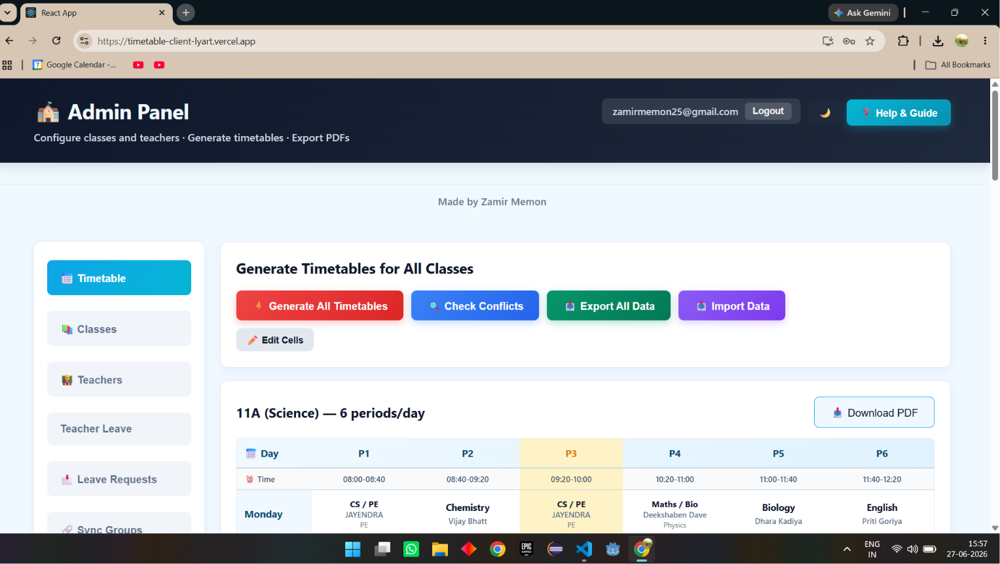

---

## 2. Teachers Tab

Add all teachers first. Just enter the name and subject, then click **Add**. Teachers can be edited or deleted anytime.

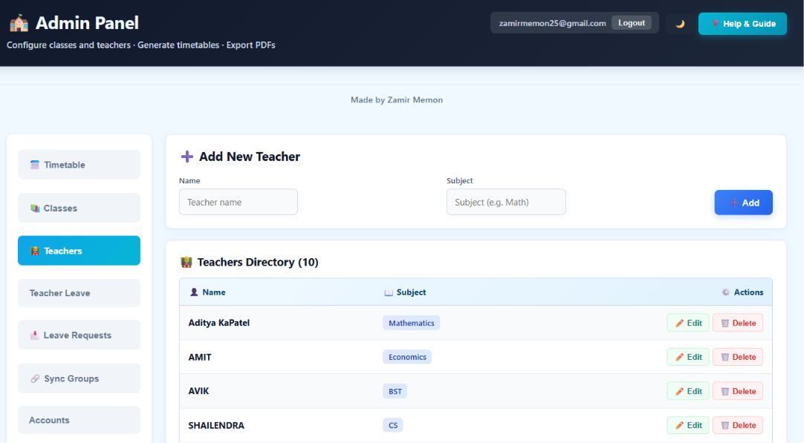

---

## 3. Classes Tab

Create a class (e.g. 11A), set the number of periods per day, and assign teachers. You can also group teachers who share the same slot — for example, if three teachers handle different electives at the same time.

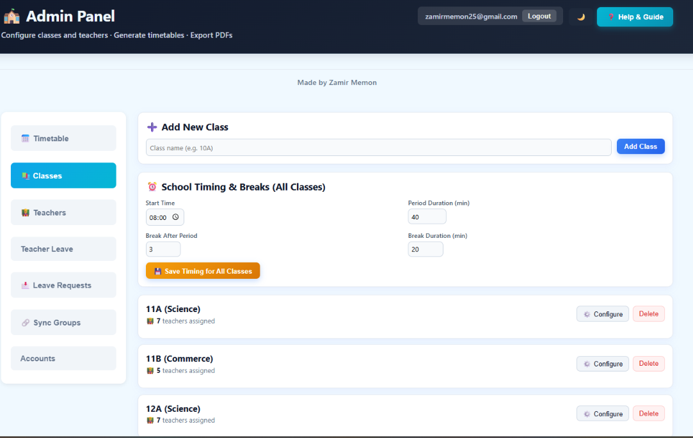

---

## 4. Generate Timetable

Click **Generate All Timetables** and the system creates a full weekly schedule for every class in seconds. No conflicts, no overlapping teachers.

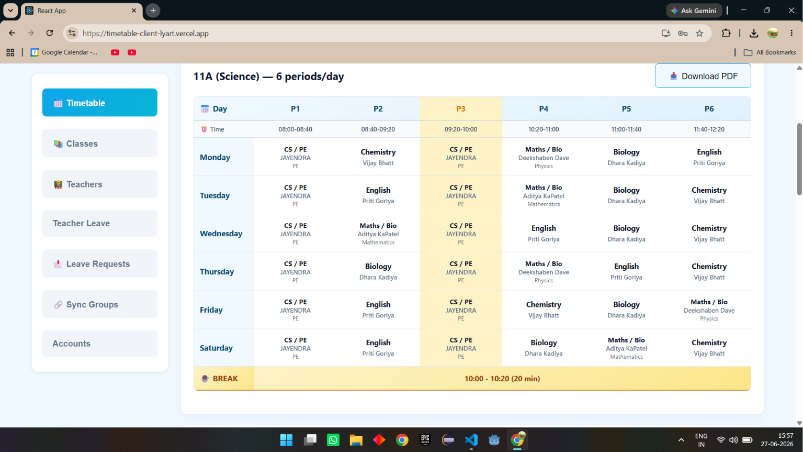

---

## 5. Edit Cells

Need to change a period? Toggle **✏️ Edit Cells** and click any cell. A popup lets you change the teacher, subject, or add elective groups.

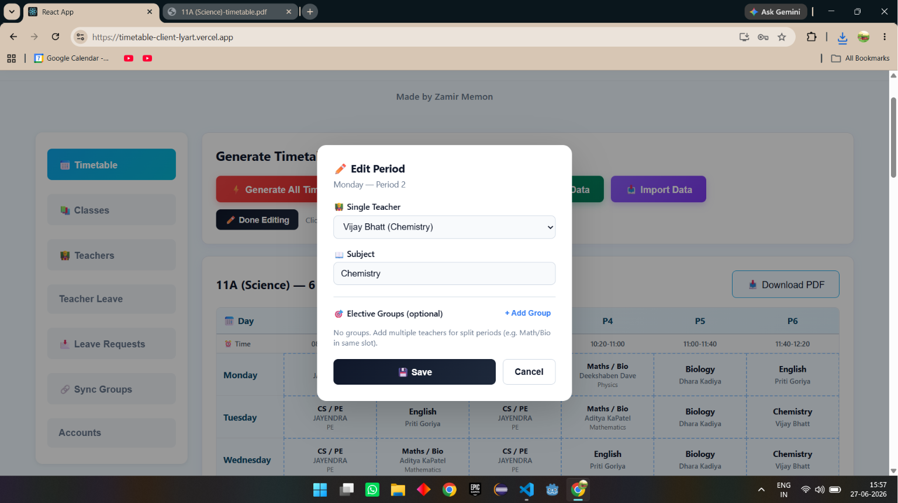

---

## 6. Download PDF

Any class timetable can be downloaded as a printable PDF file. Useful for printing and putting on staff room notice boards.

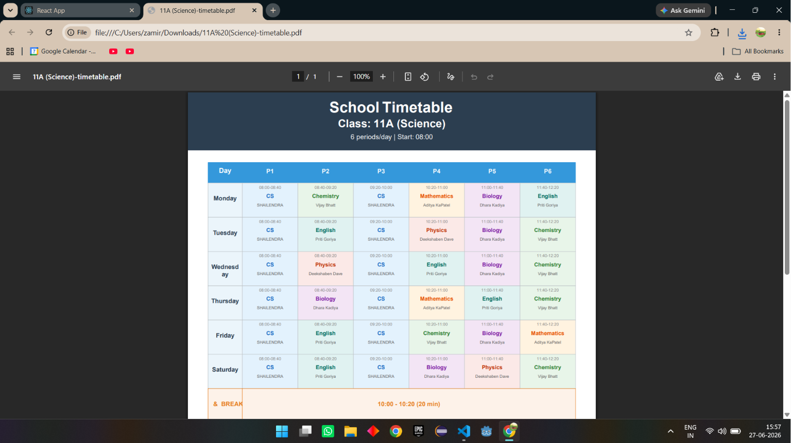

---

## 7. Sync Groups

If two classes share the same elective subject (e.g. Physical Education), you can **sync** them so they appear at the same day and period. This prevents room scheduling issues.

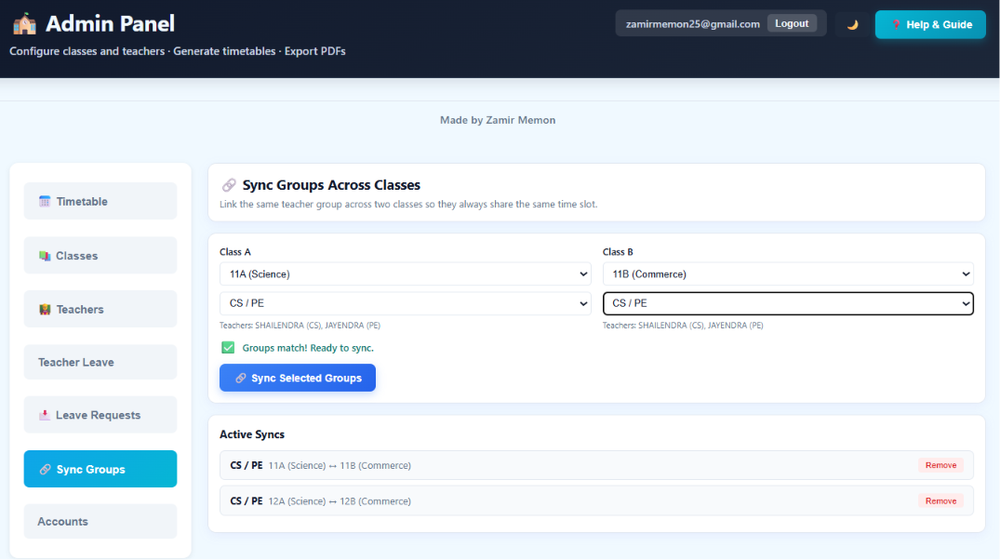

---

## 8. Accounts — Create

Create accounts for teachers and other admins. Each account gets an email and password that the teacher can use to log in and see their own schedule.

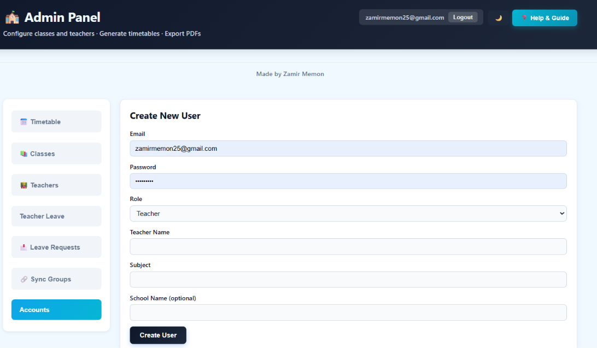

---

## 9. Accounts — List

View all user accounts in one place. You can delete accounts if needed.

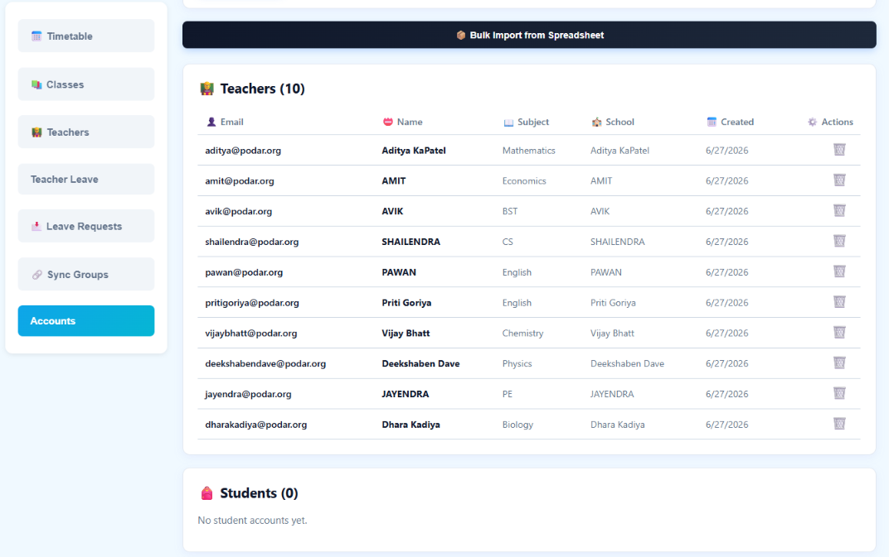

---

## 10. Teacher Panel — My Timetable

When a teacher logs in, they see **only their own schedule** — which class, which subject, and which period. Nothing else, no confusion.

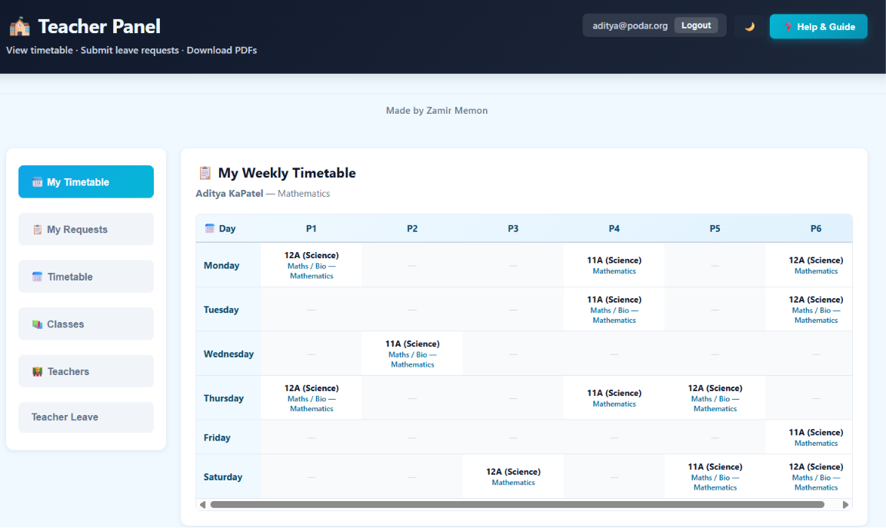

---

## 11. Teacher Panel — Leave Request

Teachers can submit a leave request by selecting a day and writing a reason. The admin reviews and approves or rejects it.

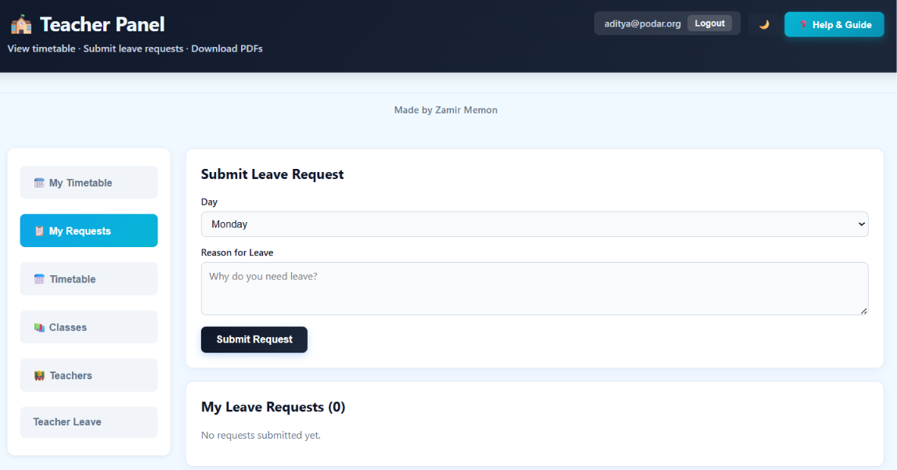

---

## Quick Summary

| Feature | What it does |
|---------|-------------|
| Auto-generate timetable | 10 seconds instead of 2-3 days |
| Edit cells | Change any period with one click |
| Export to PDF | Print-ready schedules |
| Export to Excel | All data in one spreadsheet |
| Teacher groups | Elective teachers share the same slot |
| Cross-class sync | Same subject, same time across classes |
| Teacher panel | Each teacher sees only their schedule |
| Leave requests | Teachers apply, admin approves |

---

*Built by Zamir Memon — Timetable Management System*
